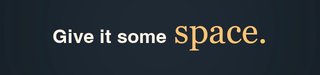

# Reverse Caption Style

Turn the **look of burned-in captions** in a reference video into an editable JSON preset. The skill samples frames, reads the visible words, and estimates how regular text and emphasized words share a line. Use the result to style new dialogue in your own renderer.

**Runs locally.** HyperFrames, Caption Studio, DaVinci Resolve, a GPU, API keys and paid services are all optional. The analyzer reads video pixels. Audio transcription, video rendering and transparent overlay export are separate steps.

## Try it on the included clip

The sample shows ordinary words and an accent face on the same baseline. The repository includes the input clip and a preset measured from it.



On macOS with Homebrew:

```sh
brew install uv ffmpeg tesseract fontconfig
git clone https://github.com/SeNorMat/reverse-caption-style.git
cd reverse-caption-style
uv run --no-project --python 3.11 --with-requirements requirements.txt python scripts/analyze.py examples/reference.mp4 --out caption-study
```

Open `caption-study/preview.jpg` to check which words the analyzer measured. Compare with the [sample preset](examples/preset.json) and [sampled frames](examples/preview.jpg). In this example the tool found the centered line, matched the regular Helvetica Bold and italic Georgia accent, and guessed italics for two large upright words. Those two words are a good place to compare the [measurement report](examples/report.json) against the clip. Installed fonts influence the result.

| Output | What you get |
| --- | --- |
| `preset.json` | Caption position, a likely animation, and three style roles: `normal`, `emphasis` and `hero`. Roles carry font family, relative size, tracking, weight, italics and fill color. |
| `preview.jpg` | A contact sheet of sampled caption regions for visual review. |
| `report.json` | Sample times, recognized words, glyph-fit scores and observations behind the motion and style estimates. |

## Requirements

| Component | Purpose |
| --- | --- |
| Python 3.10+ with Pillow and NumPy | Samples and measures glyphs. The quickstart uses Python 3.11. |
| FFmpeg and ffprobe on your PATH | Decode frames and read video metadata. Both executables come with FFmpeg. |
| Tesseract OCR and a language pack | Reads visible text. The default language is English (`eng`). Set `CAPTION_OCR_LANG` for another installed language. |
| Local fonts and Fontconfig (recommended) | `fc-match` finds installed font candidates. Installing a suspected typeface and setting `CAPTION_FONT_CANDIDATES` can improve a match. |

The quickstart uses `uv` to set up Python dependencies. If you already use a virtual environment, install them with `python -m pip install -r requirements.txt`, then run `python scripts/analyze.py reference.mp4 --out caption-study`. On Debian or Ubuntu, the native packages are `ffmpeg`, `tesseract-ocr`, `tesseract-ocr-eng`, `fontconfig`, and optionally `fonts-dejavu-core`.

## Use it as an agent skill

Clone the repository into your project's skills directory. Run **one** of the following from the project root. Install the runtime dependencies above on the machine where the agent executes commands.

**Codex**

```sh
mkdir -p .agents/skills
git clone https://github.com/SeNorMat/reverse-caption-style.git .agents/skills/reverse-caption-style
```

**Claude Code**

```sh
mkdir -p .claude/skills
git clone https://github.com/SeNorMat/reverse-caption-style.git .claude/skills/reverse-caption-style
```

Start a new session in the project and try this prompt:

> Use the reverse-caption-style skill on reference.mp4. Show me how ordinary words and emphasized words are styled, save the preset, and flag anything the samples leave uncertain.

## Work with your own reference

Choose a video that already has visible captions across several phrases. For a busy frame, narrow the search to the caption band. Add a timestamp if an accent style only appears briefly.

```sh
uv run --no-project --python 3.11 --with-requirements requirements.txt python scripts/analyze.py reference.mp4 --out caption-study --roi 0.05,0.50,0.90,0.35 --at 4.2
```

The region is `x,y,width,height` as fractions of the **displayed** frame, from the top left. Each `--at` is in seconds, and you may specify up to three. Use a fresh output directory for each study. If the analyzer cannot locate a recurring caption band, inspect the diagnostic frames and narrow the region.

## Use the preset

- **Caption Studio** can import the preset JSON through its template picker and use it on a new transcript.
- **HyperFrames or a custom renderer** can map the three roles to text styles. Multiply size and tracking by frame width, position the caption block at `x × width` and `y × height`, and implement the motion hint (`phrase`, `reveal`, or `pop`) using the new speaker's word timings. This repository supplies the measurements. A renderer supplies timing and draws the overlay.
- **DaVinci Resolve** can use an overlay rendered by your caption editor. The preset is a JSON style description, with no Resolve plugin or installer bundled.

Font names are the closest installed matches. A role with little visual evidence can inherit the regular style. Review short animations, outlines, shadows, gradients and karaoke effects against the sampled frames. Each study may include visible text and image crops from its input.

## License

Released under the [MIT License](LICENSE).
